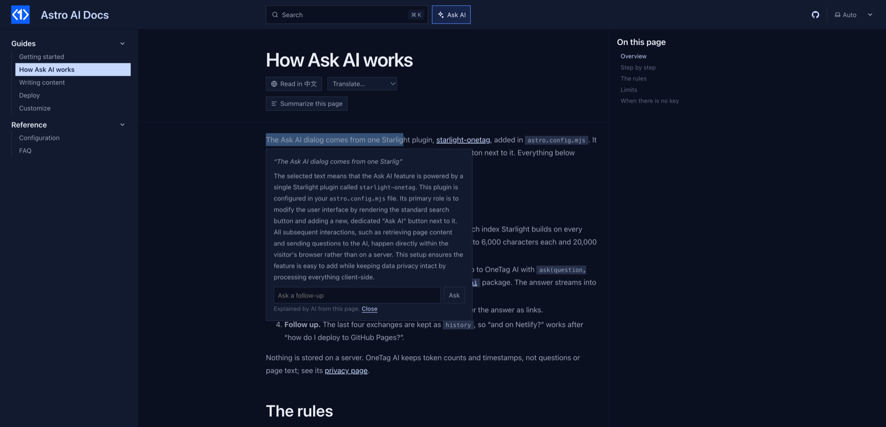

# starlight-onetag-selection

Select any text in your [Starlight](https://starlight.astro.build) docs and an **Ask AI** button appears next to it. One click explains the selection in the context of the page; readers can ask follow-ups in the same card.



- Works on any text in the docs content: a term, a sentence, a config option, a line of code.
- The explanation sees the whole page, so "this" and "it" are understood.
- Escape or a click outside closes it.

Live demo: the [Astro AI Docs](https://fengyiqicoder.github.io/astro-ai-docs/) template runs every starlight-onetag plugin.

## Install

```bash
npm install starlight-onetag
```

This plugin ships inside the [`starlight-onetag`](https://www.npmjs.com/package/starlight-onetag) package (0.2.0 and later) as `starlight-onetag/selection`. This repository holds its source and docs.

```js
// astro.config.mjs
import { defineConfig } from "astro/config";
import starlight from "@astrojs/starlight";
import starlightOnetagSelection from "starlight-onetag/selection";

export default defineConfig({
  integrations: [
    starlight({
      title: "My docs",
      plugins: [starlightOnetagSelection()],
    }),
  ],
});
```

## Before you deploy: get a free key

On localhost it works without a key, on a shared demo key. A deployed site needs its own: pass it as `starlightOnetagSelection({ key: "ot_..." })` or set `PUBLIC_ONETAG_KEY` in `.env`. Without one, readers see a line saying AI is not set up, and the build prints a warning.

Fill in your email at [onetagai.com](https://onetagai.com/?ref=starlight-onetag-selection), or run this; the key arrives in that inbox (one key per email, 1,000,000 free tokens a month):

```bash
curl -X POST https://onetagai.com/api/signup -H "Content-Type: application/json" -d '{"email":"you@example.com"}'
```

The key is designed to be public, like an analytics ID: it ends up in the built HTML and can only spend that account's allowance. One key works for every starlight-onetag plugin on the site.

## Options

| Option | Default | What it does |
| --- | --- | --- |
| `key` | `""` (or `PUBLIC_ONETAG_KEY`) | The OneTag AI key. |
| `label` | `"Ask AI"` | Text of the button next to the selection. |
| `minChars` | `2` | Shortest selection that shows the button. |
| `maxChars` | `2000` | Longest selection that shows the button. |
| `lang` | page language | Language of the explanations. |
| `rules` | see `index.js` | Instructions given to the model. |
| `maxTokens` | `400` | Answer length cap. |
| `site` | `https://onetagai.com` | Where the API lives, for self-hosted deployments. |

## How it works

1. On click, the selected text, the paragraph it sits in and the page text (up to 12,000 characters) go to OneTag AI from the browser through the [`onetagai`](https://www.npmjs.com/package/onetagai) package.
2. The answer streams into a card under the selection; follow-ups keep the last three exchanges.

The plugin adds no component overrides, so it works next to any other Starlight plugin or custom component. The AI code is a separate chunk loaded the first time a reader uses the feature; page speed stays where it was. Nothing is stored on a server: OneTag AI keeps token counts and timestamps, not page text or questions.

## More AI for Starlight

- [starlight-onetag](https://github.com/fengyiqicoder/starlight-onetag): Ask AI dialog next to the search box, answered from your pages
- [starlight-onetag-search](https://github.com/fengyiqicoder/starlight-onetag-search): AI answer inside the search dialog, above the Pagefind results
- [starlight-onetag-translate](https://github.com/fengyiqicoder/starlight-onetag-translate): "Read in <your language>" button: AI translation of the page for the reader
- [starlight-onetag-explain](https://github.com/fengyiqicoder/starlight-onetag-explain): "Explain this code" under every code block
- [starlight-onetag-summary](https://github.com/fengyiqicoder/starlight-onetag-summary): "Summarize this page" box at the top of long pages

## License

MIT. Powered by [OneTag AI](https://onetagai.com/?ref=starlight-onetag-selection).
